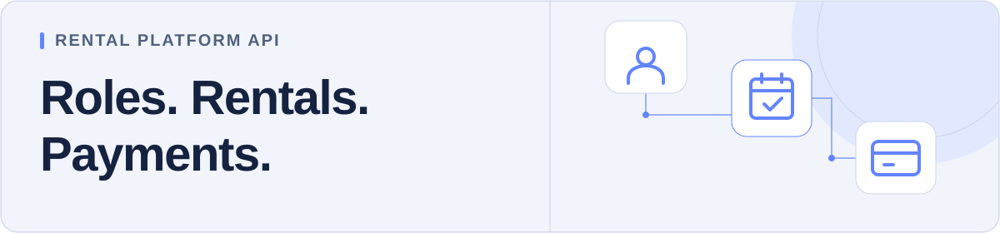

<picture>
  <source media="(prefers-color-scheme: dark)" srcset="./assets/profile/hero.svg" />
  <source media="(prefers-color-scheme: light)" srcset="./assets/profile/hero-light.svg" />
  
</picture>

  <a href="https://portfolio-harun-liard.vercel.app/"><strong>Portfolio</strong></a> &nbsp; · &nbsp;
  <a href="https://www.linkedin.com/in/harunmern/"><strong>LinkedIn</strong></a> &nbsp; · &nbsp;
  <a href="mailto:harunabhi4@gmail.com"><strong>Email</strong></a>

I'm **Harun**, a full stack developer based in Bangladesh. I build TypeScript APIs, model relational data, and connect backend workflows with React interfaces.

## Selected work

### [GearUp Backend](https://github.com/harunhira69/gearup-backend)

<a href="https://github.com/harunhira69/gearup-backend">
  <picture>
    <source media="(prefers-color-scheme: dark)" srcset="./assets/profile/projects/gearup.svg" />
    <source media="(prefers-color-scheme: light)" srcset="./assets/profile/projects/gearup-light.svg" />
    
  </picture>
</a>

A rental platform API connecting customers, equipment providers, and admins. Covers gear listings, rental and review workflows, input validation, and Stripe payments.

**TypeScript · Express · Prisma · PostgreSQL · JWT · Stripe · Zod**

[Explore repository →](https://github.com/harunhira69/gearup-backend) · [API deployment](https://gearup-backend-tan.vercel.app/)

### [PrismaPress](https://github.com/harunhira69/prisma_press)

<a href="https://github.com/harunhira69/prisma_press">
  <picture>
    <source media="(prefers-color-scheme: dark)" srcset="./assets/profile/projects/prismapress.svg" />
    <source media="(prefers-color-scheme: light)" srcset="./assets/profile/projects/prismapress-light.svg" />
    
  </picture>
</a>

A publishing API with JWT authentication, user profiles, post search and statistics, and Stripe subscriptions, backed by Prisma and PostgreSQL. The comments module is in development.

**TypeScript · Express · Prisma · PostgreSQL · Stripe**

[Explore repository →](https://github.com/harunhira69/prisma_press)

## More work

- **[Football Ticket Booking](https://github.com/harunhira69/football_ticket_booking)** — PostgreSQL schema design, relational constraints, joins, aggregates, and subqueries.
- **[PawMart](https://github.com/harunhira69/PawMart-client)** — A React/Express marketplace with Firebase sign-in, MongoDB, listings, orders, and reports. [Backend](https://github.com/harunhira69/PawMart-server) · [Application](https://pawmart-adf30.web.app)
- **[Personal portfolio](https://github.com/harunhira69/portfolio-harun)** — A React interface built with GSAP, Locomotive Scroll, Sass, and Vite. [Visit](https://portfolio-harun-liard.vercel.app/)

## Core stack

**Backend** &nbsp; TypeScript · Node.js · Express · REST APIs · JWT · Zod

**Frontend** &nbsp; React · Next.js · Tailwind CSS

**Data & integrations** &nbsp; PostgreSQL · Prisma · MongoDB · Stripe · Firebase

**Current focus:** NestJS and Fastify through active project work, with an emphasis on API testing, authorization, and error handling.

---

### Open to backend and full stack opportunities.

For roles, freelance projects, or open-source collaboration: **[harunabhi4@gmail.com](mailto:harunabhi4@gmail.com)**. [Résumé folder](https://drive.google.com/drive/folders/15wQGbXdHvG8Ml9yj5-YluGcUiWlWCvKd).
